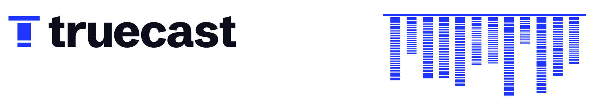

<h1>
  <picture>
    <source media="(prefers-color-scheme: dark)" srcset="site/brand/readme-header-dark.png">
    
  </picture>
</h1>

> The expert teammates Claude Code doesn't ship with.

Install expert teammates for Claude Code — a product manager, an architect, a security engineer — and
call them by name. Each works from its own playbook, versioned, and reads the brief you keep in your repo;
updates improve the playbook and never touch your brief. (In the code and the authoring docs, a teammate
is a *persona*.)

Our own `security-engineer` found a way for a hostile repo to write into your `~/.bashrc` through our
installer; we fixed it in [`834b03d`](https://github.com/wastedcode/truecast/commit/834b03d). Then we gave
the same prompt to it and two other agents, six runs each. A 76-word agent caught as many holes; ours was
the only one that ended every run on an explicit GO or NO-GO. Every run is published:
[the test](site/proof/rerun/README.md) · [truecast.dev](https://truecast.dev)

## What a teammate is
A teammate is a playbook it can open on the job, plus the brief you keep for your repo. Two owners:

- **The playbook, `core/`** — its author's: `agent.md` (identity) + `skills/` + `knowledge/`, plain
  Markdown indexed by `persona.toml`. Read-only; one global copy; you adopt updates deliberately.
- **Your brief, `instance/mandate.md`** — yours, committed in your repo, **never touched by an update.**
  (Accumulated notes in `work.md` are planned: nothing writes them yet.)

A bundled example: [`personas/product-manager/`](personas/product-manager/).

## Why a teammate, not a prompt
You could paste "act like a security expert" into your prompt. Two reasons not to:

- **Its own context window.** Each teammate runs as a native Claude Code **subagent**, so its digging
  happens off your main thread. In [the review on truecast.dev](site/proof/), `security-engineer` worked
  through 66,578 tokens in its own context and handed the session back a 2,780-token report.
- **Twelve roles, already written and kept current.** Each teammate carries a versioned playbook of
  skills it can open mid-task. You adopt its author's improvements deliberately, and your brief survives
  every update. (On catching bugs alone, a short prompt held its own in [our test](site/proof/rerun/README.md).)

## Add a teammate

Set truecast up once from your terminal (Claude Code 2.1.292 or later), then add teammates in Claude Code,
one line each:

```sh
claude plugin install truecast --marketplace wastedcode/truecast
```
```
/truecast:install product-manager
```

Already in a session? On 2.1.275 or later, `/plugin install truecast --marketplace wastedcode/truecast`
does the setup in place: it opens the plugin panel, where you choose **Install for you**. On older
versions: `/plugin marketplace add wastedcode/truecast`, then `/plugin install truecast@truecast`.

Now `product-manager` is a teammate in this project and every other one, under its own name. Ask for it
in plain words, or type `@` and pick it from the list to be sure it takes the job. Typed by hand, it's
`@agent-product-manager`.

The `truecast` plugin is the *installer* — the plugin that provides `/truecast:install`,
`/truecast:update`, `/truecast:list`, and `/truecast:remove`. You type it once, ever. Swap
`product-manager` for any of the twelve official personas: `product-researcher`, `vc-seed`,
`software-engineer`, `software-architect`, `security-engineer`, `qa`, `infrastructure`,
`product-marketer`, `ui-ux-designer`, `brand-designer`, `sales`.

Before it writes anything, `/truecast:install` shows you the plan — the version, the tools that teammate
gets, and every path it will touch — and waits for a yes. It never overwrites a file truecast didn't
write, and it copies from the marketplace clone already on your disk. First run only: if
`/truecast:install` isn't recognized yet (say, Claude Code was already open), `/reload-plugins`; if
the teammate isn't in the `@` list, restart Claude Code once. To take it all back out:
[three commands](docs/install.md#in-claude-code-recommended).

Updates come through the marketplace. In your terminal, `claude plugin marketplace update truecast`
fetches new versions of every teammate and `claude plugin update truecast@truecast` updates the installer
itself (restart Claude Code after it). Then, in a session, `/truecast:update <name>` (or `--all`). Details in
[docs/managing-personas.md](docs/managing-personas.md#which-lane-youre-on). On Windows, run Claude Code inside
WSL; native Windows isn't tested yet.

The first time you run a teammate with no job set, it asks what the project needs and works from your
answer; to make that brief stick across sessions, save it as `.truecast/agents/<name>/instance/mandate.md`. Want installs from any git URL, `doctor`, `prompt`, and an ownership ledger? Use the
`truecast` CLI below. (From CLI 0.3.0 the two lanes share one on-disk copy and can update each other's
installs; npm still serves 0.2.0.)

## Get the `truecast` CLI
```sh
npm install -g @wastedcode/truecast    # installs the `truecast` command
truecast --help
```
Or from source:
```sh
git clone https://github.com/wastedcode/truecast && cd truecast
pnpm install && pnpm build
npm link                                   # puts `truecast` on your PATH
```
Requires Node ≥ 22. **Pre-1.0:** the CLI and the programmatic API may change between `0.x` minors — see
[docs → Stability](docs/README.md#stability-pre-10).

## Install a persona with the CLI
`/truecast:install` above covers the common case. The CLI adds installs from any git URL, an ownership
ledger, plus `doctor` and `prompt`. It needs Node and a restart.

```sh
cd your-project
truecast install <git-url-or-path>[@version][#subpath]

# examples
truecast install https://github.com/wastedcode/truecast#personas/product-manager   # an official persona
truecast install ./personas/product-manager                       # local path
truecast install https://github.com/you/persona@1.2.0             # a GitHub release tag
truecast install https://github.com/you/monorepo#personas/pm      # a persona in a sub-directory
```
The twelve official personas (`product-manager`, `product-researcher`, `vc-seed`, `software-engineer`,
`software-architect`, `security-engineer`, `qa`, `infrastructure`, `product-marketer`, `ui-ux-designer`, `brand-designer`,
`sales`) live in this repo under [`personas/`](personas/) — install any with `…/truecast#personas/<name>`.
Then write the persona's job for this project in `.truecast/agents/<name>/instance/mandate.md`.

## Using a persona

However you install it, a persona runs as a native Claude Code **subagent**. Its body carries an
**index of the persona's skills** (each with a one-line summary and the path to Read), so the persona
pulls the right skill on demand. Verified: given an open-ended task it Reads the matching `SKILL.md`
files itself, then applies them. (`/truecast:install` and the CLI both materialize the subagent at
`~/.claude/agents/<name>.md`; the CLI additionally symlinks the craft into your project.)

### As a Claude Code subagent (`@<name>`)
After a CLI install, restart Claude Code, then bring the teammate into a normal session:

```
> have the product-manager pressure-test this idea: an AI that auto-prioritizes my to-dos
```
Claude delegates to the subagent (it's listed under `/agents`, and you can `@agent-product-manager` it
explicitly). The subagent runs with the tools the persona declares (`tools` in its `persona.toml`),
reads its `mandate.md` for the project job, and Reads the skills it needs.

### As a standalone `claude` (the persona *is* the main agent)
Run a full `claude` session that *is* the persona — its whole craft loaded as the system prompt.
`truecast prompt` emits that composed prompt; pipe it into `claude`:

```sh
cd your-project   # the project where you ran `truecast install`
claude --append-system-prompt "$(truecast prompt product-manager)" \
       --allowed-tools Read Grep WebSearch WebFetch \
       --model opus
```
Now the whole session thinks like the persona. `--allowed-tools` restricts it to the tools the persona
declares (a main agent otherwise has the full toolset); `--model` matches its `modelHint`. (`truecast
prompt <name>` just prints the system prompt — `--append-system-prompt-file <file>` works too.)

## Contribute a persona to the catalog

truecast runs **one curated catalog**, the marketplace this repo publishes, so a user adds it once and
installs everything as `<name>@truecast`. To get your persona in, **open a PR here** with your
`personas/<name>/core/` (the source: `agent.md`, `skills/`, `knowledge/`, `persona.toml`). You don't
generate plugin files or run `publish`; a maintainer publishes it into the catalog when your PR lands.
Start from [`docs/authoring-personas.md`](docs/authoring-personas.md) and [`CONTRIBUTING.md`](CONTRIBUTING.md).

## Ride a teammate along in a repo

Put a teammate in a project so everyone working in it gets the same one, with nothing to install by hand.
Add this to the repo's `.claude/settings.json` and commit it:

```json
{
  "extraKnownMarketplaces": {
    "truecast": { "source": { "source": "github", "repo": "wastedcode/truecast" } }
  },
  "enabledPlugins": { "product-manager@truecast": true }
}
```
When someone opens the repo in Claude Code and trusts the folder, Claude Code offers to install the
teammate for them. The expert travels with the code, not with each person's setup. Note the name: a
persona installed this way is namespaced by its plugin, so it answers to `product-manager:product-manager`
rather than a bare `@product-manager` — that's the price of portability, and it's why
`/truecast:install` exists for the per-machine case. Only commit this for a marketplace you control, and
review what a marketplace ships before you trust a folder.

## Managing personas
```sh
truecast list [--check] [--project]   # what's installed; running vs latest; what's attached here
truecast update [<name>] [--dry-run]  # adopt newer craft; classified (patch/minor/major); your instance untouched
truecast remove <name> [--global]     # detach from this project (keeps instance/), or purge globally
truecast doctor [--fix]               # inspect + repair (drift, dangling pointer, stale artifacts)
```
See [docs/managing-personas.md](docs/managing-personas.md) for the full model (consent, drift/`--force`,
the discriminated update outcomes).

## How it works
`install` resolves the project (the nearest enclosing git repo, or `--project <path>`), fetches the persona into a
global cache (`~/.truecast/personas/<name>/`), symlinks the craft into the project, scaffolds your
editable `instance/`, and materializes the subagent at `~/.claude/agents/<name>.md` — whose body indexes
the skills/knowledge for the persona to Read on demand (skills are **not** copied as global slash-
commands; they're the persona's private craft). Every file truecast writes is tracked in a **per-persona
ledger** (`owned.json`), under a per-persona lock, so concurrent installs never collide and truecast
never clobbers a file it doesn't own.

`publish` is the parallel path. Instead of materializing into `~/.claude`, it generates the committed
plugin and marketplace files that Claude Code installs from.

## Status
Working end-to-end — `install` · `update` · `list` · `remove` · `doctor` · `prompt` · `publish`,
with a per-persona ownership ledger, atomic updates, and a sandboxed git/GitHub fetch. The same four verbs
run from inside a Claude Code session as `/truecast:install` and friends, no terminal. Verified driving real
Claude Code sessions (as a subagent and as a standalone agent); `publish` generates a Claude Code plugin
marketplace (validated with `claude plugin validate`). Pre-1.0; the self-improving loop is next.

## Docs
[`docs/`](docs/) — [install](docs/install.md), [managing personas](docs/managing-personas.md),
[authoring personas](docs/authoring-personas.md), and a shipped-vs-planned status table. (Kept in step
with the code: a feature isn't done until it's documented.)

## Develop
```sh
pnpm install
pnpm typecheck && pnpm test && pnpm lint && pnpm build
```
Requires Node ≥ 22 and pnpm. License: MIT. Design notes live in `internal/` (git-ignored).
